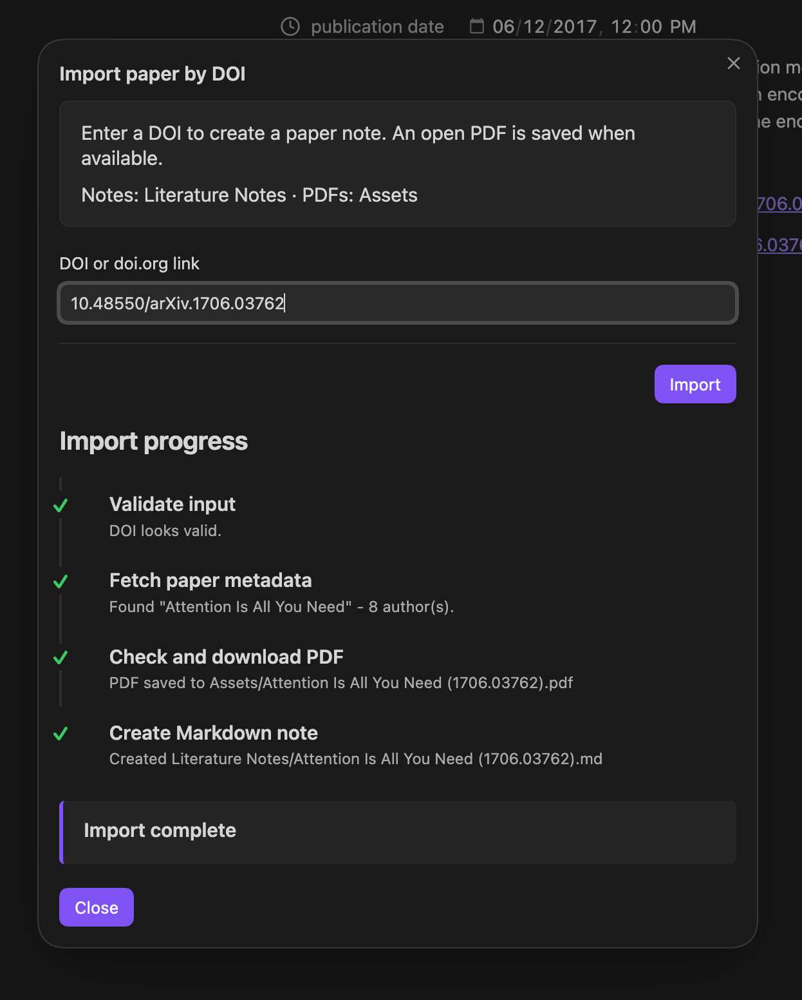
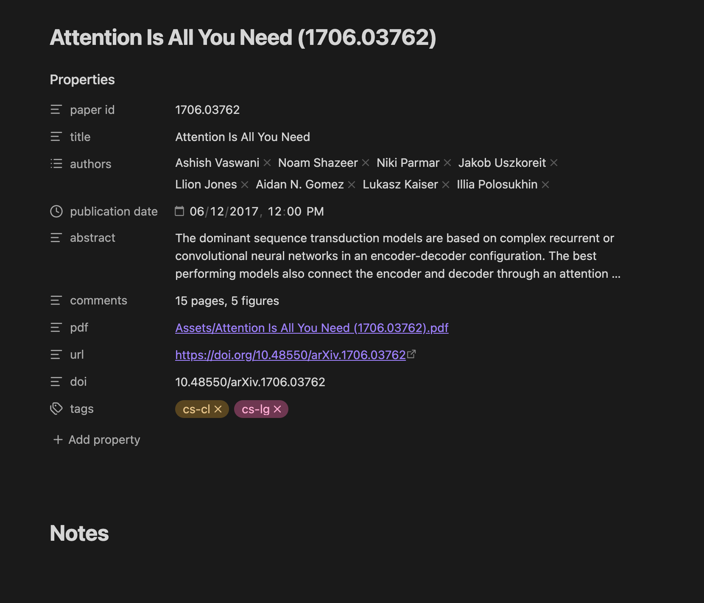

# Paper DOI

An Obsidian plugin that creates a literature note from a DOI. It can also download a PDF when an accessible PDF URL is available.

## Screenshots

## Features

- Accepts a DOI such as `10.1038/323533a0` or a DOI URL such as `https://doi.org/10.1038/323533a0`.
- Looks up citation metadata from Crossref and OpenAlex.
- Uses arXiv metadata for `10.48550/arXiv.<id>` DOIs, including the abstract, comments, categories, and arXiv PDF.
- Tries Europe PMC for abstracts and keywords, and a Nature page fallback for Nature abstracts.
- Creates a Markdown note from a configurable template and saves a PDF when an accessible PDF is found.
- Shows import progress and reports whether the PDF was saved.

## Install

Copy this folder into `<vault>/.obsidian/plugins/paper-doi-importer/`. In Obsidian, reload or restart the app, open **Settings → Community plugins**, and enable **Paper DOI**.

## Use

1. Open the command palette.
2. Run **Import paper from DOI**.
3. Enter a DOI or `https://doi.org/` link and select **Import**.

The note opens after it is created. Existing notes are kept; the importer adds a numbered suffix when a note with the same generated name already exists.

## Settings

Open **Settings → Paper DOI** to set:

- **Literature note folder**: vault-relative destination for generated Markdown files. Default: `Literature Notes`.
- **PDF folder**: vault-relative destination for downloaded PDFs. Default: `Assets`.
- **Markdown template**: vault-relative Markdown file used to format each note. Default: `Templates/paper-import.md`.

The selected template must exist. The default template uses these replacement fields:

| Field | Value |
| --- | --- |
| `%%PAPER_ID%%` | arXiv ID when available, otherwise the DOI suffix |
| `%%TITLE%%` | Paper title |
| `%%AUTHORS%%` | YAML list of authors |
| `%%PUBLICATION_DATE%%` | Publication date, when available |
| `%%ABSTRACT%%` | Abstract, when available |
| `%%COMMENTS_PROPERTY%%` | Comments property, omitted when empty |
| `%%PDF_LINK%%` | Obsidian link to the downloaded PDF, or an empty value |
| `%%URL%%` | Canonical `https://doi.org/…` URL |
| `%%DOI%%` | DOI |
| `%%TAGS%%` | YAML list of tags, when available |

## PDF availability

PDF downloads are best-effort. The plugin tries PDF URLs returned by metadata providers and the arXiv PDF endpoint. A publisher may require a subscription, block automated requests, or provide no usable PDF URL. In those cases, the Markdown note is still created and the progress panel explains that no PDF was saved.

## Files

- `manifest.json` — Obsidian plugin metadata.
- `main.js` — plugin implementation.
- `styles.css` — modal and progress styling.
- `README.md` — usage and configuration guide.
